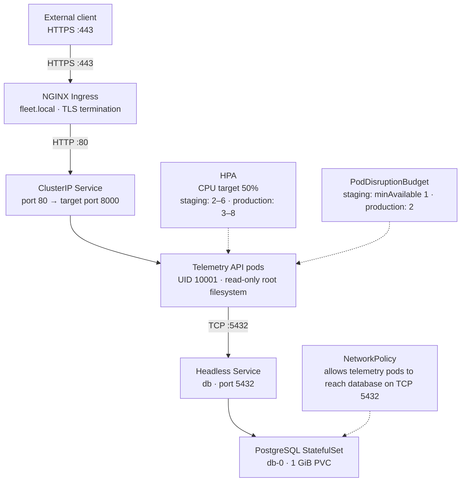

# Production Kubernetes Architecture & GitOps Platform (`k8s-resilient-cluster`)


A Kubernetes orchestration repository demonstrating a telemetry API deployment, stateful database persistence, Layer-7 TLS Ingress routing, database NetworkPolicy controls, least-privilege RBAC, Horizontal Pod Autoscaling (HPA), CEL admission policy, and multi-environment Helm 3 packaging.

---

## 1. System Architecture & Packet Flow



---

## 2. Production Engineering Capabilities

| Domain | Implementation details |
| --- | --- |
| Stateless workload | Deployment with RollingUpdate settings (`maxSurge: 1`, `maxUnavailable: 0`), `startupProbe`, separate `livenessProbe` (`/api/v1/info`) and `readinessProbe` (`/healthz`), and preferred pod anti-affinity. |
| Stateful database | PostgreSQL 16 StatefulSet (`db-0`), headless Service, and 1 GiB PersistentVolumeClaim. The API Deployment waits for PostgreSQL with an `initContainer` running `pg_isready`. |
| Database backup example | The nightly CronJob invokes `pg_dump` but pipes its output to `head` and does not save a backup. Treat it as a demonstration, not a usable disaster-recovery backup. |
| Layer 4 and Layer 7 networking | NGINX Ingress with TLS configured through `fleet-tls-secret`, a ClusterIP Service, and a NetworkPolicy that allows telemetry-labeled pods to connect to PostgreSQL on TCP 5432. |
| Container and cluster security | The API runs as UID 10001 with `readOnlyRootFilesystem: true`, a `/tmp` `emptyDir`, and dropped Linux capabilities. The ValidatingAdmissionPolicy denies privileged regular containers in `fleet-system`. |
| Autoscaling and governance | HPA targets 50% CPU utilization. Staging scales from 2–6 replicas with `minAvailable: 1`; production overrides this to 3–8 replicas with `minAvailable: 2`. The chart also configures a ResourceQuota and LimitRange. |
| Helm 3 packaging | The chart deploys the telemetry API and related resources; database and cluster admission-policy resources are applied separately from `manifests/`. Staging and production values are provided. |

---

## 3. Repository Structure

```text
k8s-resilient-cluster/
├── README.md
├── .gitignore
├── manifests/                        # Raw Kubernetes manifests
│   ├── 00-namespace.yml              # Isolated fleet-system namespace
│   ├── 01-deployment.yaml            # Hardened API Deployment + InitContainer
│   ├── 01-deployment.yaml.bcp        # Backup copy; not applied by the runbook
│   ├── 02-service.yaml               # Layer-4 ClusterIP Service
│   ├── 03-db-config.yaml             # Decoupled ConfigMap & Secret
│   ├── 04-db-pvc.yaml                # PersistentVolumeClaim (1 GiB)
│   ├── 05-db.yaml                    # PostgreSQL StatefulSet + Headless Service
│   ├── 06-ingress.yaml               # Layer-7 NGINX TLS Ingress
│   ├── 07-network-policy.yaml        # Zero-Trust Database Firewall
│   ├── 08-rbac-and-governance.yaml   # ServiceAccount, Role, RoleBinding, Quota, LimitRange
│   ├── 09-hpa-and-pdb.yaml           # HorizontalPodAutoscaler & PodDisruptionBudget
│   ├── 10-db-backup-cronjob.yaml     # Nightly logical pg_dump CronJob
│   └── 11-admission-policy.yaml      # Native CEL ValidatingAdmissionPolicy
└── charts/
    └── fleet-telemetry/              # Helm 3 chart for the telemetry API
        ├── Chart.yaml
        ├── values.yaml               # Default / staging configuration
        ├── values-prod.yaml          # Production overrides
        └── templates/
            ├── _helpers.tpl
            ├── deployment.yaml
            ├── hpa-pdb.yaml
            ├── ingress.yaml
            ├── rbac.yaml
            └── service.yaml
```

---

## 4. Operational Runbook

### Prerequisites

- Kubernetes 1.30 or later, `kubectl`, and Helm 3. The cluster version is needed for the `admissionregistration.k8s.io/v1` ValidatingAdmissionPolicy.
- A default StorageClass that can provision a 1 GiB `ReadWriteOnce` volume. If your cluster has no default StorageClass, set one explicitly in `manifests/04-db-pvc.yaml`.
- A CNI plugin that enforces NetworkPolicies and Metrics Server for HPA CPU metrics.
- An NGINX Ingress Controller, a TLS certificate/key pair for `fleet.local`, and DNS or a local hosts-file entry pointing `fleet.local` to the ingress controller.
- A Kubernetes identity allowed to create the required namespaced resources and the cluster-scoped ValidatingAdmissionPolicy and binding.
- Access to pull the telemetry API image configured in `charts/fleet-telemetry/values.yaml`.

Before deploying, check the local tools and cluster prerequisites:

```bash
kubectl version --client
helm version --short
kubectl get storageclass
kubectl get ingressclass nginx
kubectl top nodes
kubectl auth can-i create validatingadmissionpolicies.admissionregistration.k8s.io
```

### A. Provision Stateful Foundation & Security Guardrails

```bash
kubectl apply -f manifests/00-namespace.yml \
              -f manifests/03-db-config.yaml \
              -f manifests/04-db-pvc.yaml \
              -f manifests/05-db.yaml \
              -f manifests/07-network-policy.yaml \
              -f manifests/10-db-backup-cronjob.yaml \
              -f manifests/11-admission-policy.yaml
```

The foundation command creates the `fleet-system` namespace and database resources. The Secret manifest contains a sample credential: replace it before deployment, and do not commit real credentials. For non-disposable environments, provision the Secret through your approved secret-management process. After the namespace exists, create the Ingress TLS Secret before installing the chart:

```bash
kubectl create secret tls fleet-tls-secret \
  --cert=path/to/tls.crt \
  --key=path/to/tls.key \
  -n fleet-system
```

### B. Deploy & Upgrade Stateless Stack via Helm 3

```bash
# 1. Lint & Validate Chart
helm lint ./charts/fleet-telemetry

# 2. Deploy Staging Release with Atomic Auto-Rollback
helm upgrade --install fleet-telemetry ./charts/fleet-telemetry \
  -n fleet-system --atomic --timeout 2m

# 3. Promote Production Overrides
helm upgrade --install fleet-telemetry ./charts/fleet-telemetry \
  -n fleet-system -f ./charts/fleet-telemetry/values-prod.yaml \
  --atomic --timeout 2m
```

---

## 5. Production Triage & Incident Post-Mortems

### Liveness Probe Cascade Deadlock (`CrashLoopBackOff` with Exit Code 0)

**Root cause:** Pointing `livenessProbe` at `/healthz` (which queries PostgreSQL) caused kubelet to kill and restart API containers whenever the database took more than two seconds to initialize.

**Resolution:** Decoupled probes by pointing `livenessProbe` to lightweight `/api/v1/info` and keeping deep dependency verification on `readinessProbe` (`/healthz`).

### Kubernetes Docker-Link Environment Variable Collision (503 Service Unavailable)

**Root cause:** Naming a Kubernetes Service `db` causes kubelet to inject the legacy Docker-link variable `DB_PORT="tcp://10.x.x.x:5432"`, breaking integer port parsing in Python.

**Resolution:** Explicitly injected `DB_PORT` from the `fleet-db-config` ConfigMap to override auto-injected service-link variables.

### Pod-level `securityContext` UID Mismatch in initContainers (`Init:0/1`)

**Root cause:** Pod-level `runAsUser: 10001` was inherited by the `postgres:16-alpine` initContainer, causing `pg_isready` to fail its local `/etc/passwd` lookup (Alpine Postgres uses UID 70).

**Resolution:** Scoped `runAsUser: 70` and `-U postgres` specifically to the `wait-for-db` initContainer.